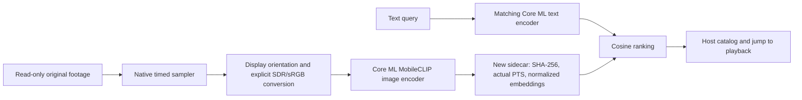

# Semantic footage indexing

PXLmpeg 0.7 implements an optional **sampled visual search prototype**. `PXLAnalysis` supplies a Core ML image/text encoder pair, bounded native sampling, validated embedding sidecars and timestamped cosine ranking. Pixel Deck remains the intended catalog/UI consumer; no existing application has been switched over.

## Responsibilities

Core media processing builds and runs without models, databases, downloaded weights or third-party runtimes. `PXLAnalysis` depends on the core; the core does not depend on analysis. Model assets are explicitly supplied by the host. Pixel Deck owns its catalog, vector database, search UI, playback priority, access permissions and the decision to run analysis.

## Implemented model and contracts

The default is Apple's **original MobileCLIP-S2** image/text pair; S0 remains selectable for comparison. The official [Core ML release](https://huggingface.co/apple/coreml-mobileclip) and [native example](https://github.com/apple-aiml-research/ml-mobileclip/tree/main/ios_app) avoid a conversion toolchain. Models, vocabulary and merges are pinned and SHA-256 verified by the developer fetch script. The original Swift byte-BPE tokenizer is checked against the native example's token sequences, including punctuation and Unicode. Query content is limited to 75 tokens plus start/end markers, padded to 77; unsupported length fails explicitly.

The actor owns synchronous Core ML model handles and serial operations. Only compiler-returned temporary compiled models are loaded, so arbitrary host `.mlmodelc` cache directories cannot bypass raw-asset identity checks. A persistent actor amortizes startup. Every separate CLI invocation verifies and compiles assets; this currently takes seconds even when the OS can reuse compiler caches.

Image preprocessing produces a 256 × 256 sRGB center crop. SDR BT.709 sampling uses the core required-hardware VideoToolbox decoder and contract-applied YUV colour metadata before Core Image conversion; this includes explicitly assumed untagged ALi sources. HDR sampling uses `AVAssetImageGenerator` with `forceSDR`. Both apply display rotation. HDR conversion is an analysis derivative, not a reference tone-mapping or HDR display approval. The chosen backend and preprocessing revision are recorded.

Sampling uses the video track range, a declared interval and a per-source request limit. Actual source PTS is retained separately from requested time, and duplicate actual frames are omitted. Forward requests across a presentation gap can share a future frame without being mistaken for backward seeks. Sparse samples do not imply continuous coverage.

## Records, resources and cancellation

Schema v1 includes source SHA-256 and media descriptor, source video range, sampling backend and truncation, requested/actual PTS, normalized 512-float embeddings, model/tokenizer/preprocessing identity, compute policy and elapsed indexing time. Source hashes are verified before and after indexing. Query and index model identities must match. A query reads the sidecar, not the footage; the host must validate source identity before using old results against modified files.

The prototype accepts 1–32 local supported MOV/MP4 sources, intervals from 0.1–60 seconds, up to 4096 requests per source and 4096 aggregate embeddings. Serialized sidecars are capped at 32 MiB. Regular-file admission rejects FIFO/device inputs before blocking reads. Publication uses a new exclusive destination and removes owned temporary output on failure. Originals are never rewritten.

One operation runs per actor. At most one sample/model inference is in flight. SDR decoding uses an SPS-bounded reorder window and a 256 MiB owned-media budget, on a private serial blocking queue. Core Image, Core ML and native opaque allocations are not covered by that budget. Cancellation is checked around sampling, hashing, inference and publication; an OS call already in progress may finish before cancellation returns. This is not a hard deadline for a hung native call. Separate playback and analysis scheduling remain the host's responsibility.

## Neural Engine evidence

The default `cpuAndNeuralEngine` policy permits CPU and ANE inference and excludes GPU inference; preprocessing may use Metal. `all` and `cpuOnly` are available for measurement. There is no ANE-only guarantee.

`MLComputePlan` reports supported/preferred devices and estimated cost weights. The CLI benchmark measures native prediction wall time after first predictions and five warmups. The Instruments script attaches after prewarming, records actual ANE hardware activity, and aligns it with PID-scoped image/text batch signposts. Attached hardware intervals can be generic and lack process/model attribution, so overlap supports runtime ANE participation but cannot establish an exact fraction of operations or device utilization. See [validation](../validation/semantic-search.md), [Apple's performance guide](https://developer.apple.com/documentation/coreml/analyzing-a-core-ml-model-s-performance-in-xcode) and [Core ML optimization](https://developer.apple.com/videos/play/wwdc2022/10027/).

## Next research gates

The first real-footage smoke test covers one rotated iPhone HLG original and six ALi clips. It does not establish general recall, absent-query rejection, long-form stability or responsiveness during simultaneous playback. Before catalog integration, evaluate held-out clips, exact annotated time ranges, short events, edge subjects, cuts and longer sources. Measure competing playback workloads and scheduling, total process/device memory, and reusable sampler access.

Image embeddings retrieve visual content but do not establish temporal actions. “Entering” versus “leaving,” motion direction and actions spanning cuts need ordered-frame analysis or a temporal model. Add a bounded second pass over retrieved segments only after evaluating the first pass. OCR, captions, tracking and person identity are separate capabilities. Scores are similarities, not calibrated probabilities; a ranked match is returned even when the query is absent. Adaptive sampling, persistent catalog indexing and temporal understanding remain future work.
