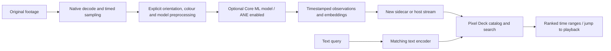

# Semantic footage indexing — research design

The selected user need is to search for **people, objects and actions**, with **Apple Neural Engine acceleration**. OCR is an optional secondary analyzer. This document records a direction, not an implemented or benchmarked feature.

## Responsibilities

PXLmpeg supplies timestamped samples, explicit image/colour/orientation contracts, cancellation and resource admission. Optional analyzers return observations with provenance. Pixel Deck owns its catalog, vector index, search UI and the decision to run analysis. Core media processing must work without a model, database, downloaded weights or third-party runtime.

## Small first experiment

Evaluate one compact image/text embedding pair before adding a captioning model. Sample a bounded number of frames and encode them once; a text query such as “a person next to a red car” retrieves candidate time ranges by embedding similarity. Apple's [MobileCLIP research and native Core ML example](https://github.com/apple-aiml-research/ml-mobileclip/tree/main/ios_app) are candidates to evaluate, not a dependency or model choice. No model is currently bundled or downloaded.

Frame embeddings can retrieve visual content but do not establish temporal actions. “Entering” versus “leaving,” direction of motion and actions spanning cuts need a temporal model or additional ordered-frame analysis. Add a bounded second pass over retrieved short segments only after evaluating the first pass. Generated descriptions and model labels remain fallible observations; similarity scores are not calibrated probabilities. Detecting “a person” does not identify that person.

## Neural Engine requirement

Use a host-supplied Core ML model that performs useful work on ANE. Initially benchmark `MLModelConfiguration.computeUnits = .cpuAndNeuralEngine`, which permits CPU and ANE and excludes GPU inference. Preprocessing may still use Metal. Benchmark `.all` separately if it improves end-to-end performance without harming playback; neither option forces every operation onto ANE.

Inspect supported/preferred devices with `MLComputePlan`. Record runtime operation placement using Xcode's model performance report and Instruments. Distinguish requested compute policy, planned placement and measured utilization. CPU fallbacks, conversion costs and model warm-up are part of the results. No ANE-only execution guarantee is exposed by this design. See [Apple's performance guide](https://developer.apple.com/documentation/coreml/analyzing-a-core-ml-model-s-performance-in-xcode) and [Core ML optimization](https://developer.apple.com/videos/play/wwdc2022/10027/).

## Sampling and records

Begin with an explicit sampling interval and maximum work per job. Adaptive shot-change sampling can follow measured recall tests; sparse sampling can miss short actions and must not imply continuous coverage. Playback has priority over background indexing. Bound in-flight samples and model working sets; cancel when the job or source generation changes.

Each record needs a schema revision, source content identity, actual source PTS and duration, sample/segment coverage, analyzer and model identity, model/preprocessing revision, compute policy and observation type. Retain embedding dimensions/normalization and text-encoder identity so incompatible models are never searched together. Text/boxes use normalized display-oriented coordinates with a declared origin. Record HDR interpretation and any explicit conversion to the model's SDR/RGB input; P010 storage is not automatically a model-compatible image.

Store new sidecars or stream records to the host. Never embed analysis by rewriting the original. A sidecar cache must detect changed source contents; the current processing engine's file identity/size/mtime fingerprint is not a content hash. Deduplication may merge similar observations into candidate spans, but should retain contributing timestamps and gaps.

## Acceptance before integration

Use a small annotated set of real ALi and iPhone clips, including rotations, SDR/HDR, small subjects, quick cuts and temporal actions. Measure search recall and false matches against exact annotated time ranges, cold/warm indexing latency, frames analyzed per second, memory, cancellation and playback responsiveness. Profile actual ANE participation on the target Mac. Compare sampling schedules and CPU + ANE versus all compute units. Select the model only after quality, conversion, tokenizer compatibility and distribution terms are understood.

The first interactive playback backend is AVPlayer and does not yet expose reusable frame leases. Analysis should use a deliberate media sample API/worker; attaching repeated image extraction to the UI timer would couple indexing to playback and duplicate expensive work. Model execution and catalog integration are separate follow-up implementation milestones.
