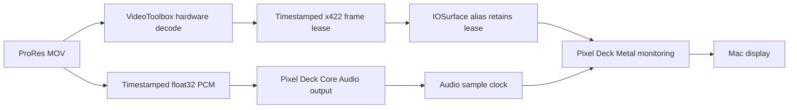

# Pixel Deck native playback research

The first consumer adapter now lives in Pixel Deck's
`codex/pxlmpeg-prores-playback` branch. It connects `PXLProfessionalMedia` to
Pixel Deck's existing Metal monitoring renderer and Core Audio sample clock.
It consumes this public package; engine sources are not copied into the app.

Signal flow:



The consumer owns presentation, device selection, monitoring transforms and
transport. It retains the frame lease until Metal completes, prepares one native
frame ahead, and treats reservation pressure as backpressure. Audio gaps and
seeks use the source timeline; after audio ends, remaining picture uses the
host fallback clock. Rapid seeks coalesce to the latest request.

## Scope

The separate **Pixel Deck PXL Research** bundle requires macOS 15. Native
selection currently admits local, unrotated, tagged Rec.709 ProRes
Proxy/LT/422/HQ MOV with supported PCM or no audio, without an external-audio
override. Pixel Deck's normal macOS 14 app keeps its compatibility backend.
Unsupported media and narrowly identified hardware-unavailable errors use
compatibility playback; corrupt data is not silently reclassified.

PXLmpeg's core remains free of third-party packages and binary dependencies.
Pixel Deck separately retains its FFmpeg compatibility features. Native DeckLink
output is gated and is not covered by this first local playback acceptance.

## Verification

On M3 Ultra, the supplied real 1920 × 1088 ProRes HQ / 24-bit stereo PCM render
produced **49 Metal-rendered video frames and 98,000 scheduled audio sample
frames** in the actual renderer/audio-clock harness. Maximum sampled
presentation skew was **20.67 ms**. It verified nonblack GPU output, lease
release after GPU completion, pause, seek, source replacement and unchanged
original SHA-256. Automated audio was muted; its output clock still ran.

The full app reached EOF with 49 Metal completions, coalesced rapid seeks to
1.25 seconds and resumed to EOF. A separate derivative with PCM shortened to
0.4 seconds reproduced the post-seek zero-buffer clock stall, then passed after
the host fix. [Sanitized results](../validation/2026-10-15-pixel-deck-playback.json).

Both normal and research app configurations build. Pixel Deck's declared
`make test` checks passed, with Sony SDK checks skipped because that optional SDK
is unprepared. The focused PXL professional suite passed 16 tests; the full suite ran 128 with 113 passing, 15 optional tests skipped and no failures. Independent
static review findings were corrected and re-reviewed.

This roughly two-second acceptance case does not establish long-session
stability, audible-sync or calibrated-color approval, HDR/rotation, 4444/alpha,
native MXF/XAVC, export, or hardware DeckLink playback. The earlier semantic-search
system stall remains unresolved and no analysis model runs in this path.

## Reproduce in Pixel Deck

Use sibling `Pixel Deck` and `PXLmpeg` checkouts and follow Pixel Deck's dependency
setup. In Pixel Deck:

```sh
Scripts/build_pxl_research.sh
Scripts/test_pxl_playback.sh /absolute/path/clip.mov
open -n '.build/PXLApp/Build/Products/Debug/Pixel Deck PXL Research.app' \
  --args --pxl-source /absolute/path/clip.mov
```

The separately named local build does not replace the normal installed app and
is not a notarized public release. Original footage, private paths and runtime
logs stay outside Git.


## Longer color-enabled camera-source check

A later full 17:16.4 FS7 4K25 MXF run validated the compatibility hardware decode
path with PXLmpeg camera metadata, corrected Metal color and the real audio
clock. EOF, middle/end seeks and audio-clock resume passed; no scheduling drops
or audio underruns were reported. The small GPU-completion/selection gap remains
unresolved. This extends camera-source playback coverage; long native ProRes,
frame-perfect output, audible/physical sync and hour/overnight stability remain
separate. See [sustained result and limitations](../validation/fs7-sustained-playback.md).
