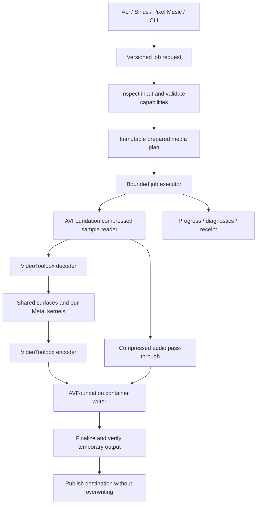

# PXLmpeg architecture

Date: 2026-10-13

Status: proposed architecture prepared from the user's approved direction. This document specifies intended behavior; it does not claim implementation or runtime verification.

## 1. Intent and decisions

Build a small, powerful native media engine for M-series Macs. Swift and original Metal kernels form the implementation; Apple system frameworks provide supported access to hardware and media infrastructure. The core has no third-party dependencies. The first consumers are ALi Imagine, Sirius, and Pixel Music.

User-confirmed constraints:

- Apple Silicon first, replacing the earlier cross-platform-first direction.
- Reusable media engine with modern architecture and an AI-friendly interface.
- Swift + Metal; no third-party dependencies in the core.
- Own the essential implementation and avoid importing a large legacy engine.

Selected architecture: a Swift package with a small public media model, a validating planner, a bounded executor, and Apple backend modules. A CLI exercises exactly the same public engine. Write original processing kernels; use VideoToolbox for codec hardware and AVFoundation for container access.

Alternatives considered: an FFmpeg wrapper cannot provide the desired dependency boundary; rewriting complete codec and container stacks initially would delay the hardware-processing objective. Neither is the selected foundation.

Proposed engineering defaults, adjustable before implementation:

- Deployment floor: macOS 15.0; runtime architecture: arm64 Apple Silicon.
- Minimum toolchain: Swift 6.0 with full Xcode and its Metal tools; Swift 6 language mode.
- The first implementation is offline file processing. Live preview and real-time audio require separate execution policies later.
- A library and CLI ship before a graphical application or background service.

## 2. Ownership and dependency contract

PXLmpeg owns sample-level timing, a media-processing graph inside one job, pixel/audio operations, buffer lifetimes, hardware session management, and technical execution receipts. It does not own creative projects, reviews, timelines in Resolve, model downloads, LLM conversations, or scheduling across products.

Sirius may submit a PXLmpeg media job as one backend operation. Its semantic graph and cross-job/model scheduler remain authoritative. PRS and ALi retain creative lineage and approval records. A PXLmpeg receipt records technical execution, never artistic approval or publication.

| Layer | Allowed dependencies | Excluded |
| --- | --- | --- |
| Public model | Swift standard library, Foundation | GPU handles, app-specific types, model runtimes |
| Engine | Model, first-party Apple adapters, Foundation, CryptoKit, OSLog, Dispatch | subprocess-based media execution, network services |
| Apple media adapter | AVFoundation, CoreMedia, VideoToolbox, CoreVideo, IOSurface | libavcodec/libavformat, bundled codec binaries |
| Metal adapter | Metal, CoreVideo, IOSurface, our shaders | third-party shaders or rendering frameworks |
| CLI | Engine, Foundation, Darwin | external argument-parser package |
| Later audio adapter | AudioToolbox/Core Audio, Accelerate, original DSP | required third-party DSP runtime |
| Optional AI adapters | explicit separate modules | reverse dependencies from the core onto adapters |

Apple frameworks and the Swift runtime are still dependencies; the promise is zero third-party dependencies, not independence from macOS. Core ML is optional system integration. Any third-party inference runtime must live outside the core dependency graph, preferably behind the host application's boundary.

No source extraction from FFmpeg or other projects is planned. Copying source retains its license and maintenance obligations. Fixtures need their own origin records; no production media is copied into tests.

## 3. System shape



This is a media graph, but the first public request is an explicit transform recipe rather than a generic plugin language. The planner lowers it into internal stages. Add graph branching and a node registry only when actual operations require them.

The creative-core cycle is expressed concretely: inspect available capabilities, select one explicit supported plan, execute against measured limits, preserve a receipt, and revise by making a new request. Silent quality changes and hidden fallback are excluded.

## 4. Package boundaries

One first-party Swift package; no external package dependencies:

| Target | Responsibility | Depends on |
| --- | --- | --- |
| `PXLMedia` | Codable request/response types, rational media time, errors, capability descriptions | system only |
| `PXLAppleMedia` | inspection, compressed sample I/O, VT sessions, buffer leases, reservations and packet timing | `PXLMedia` |
| `PXLMetal` | texture mapping, shaders, GPU completion, CPU reference helpers in tests only | `PXLMedia`, `PXLAppleMedia` |
| `PXLmpeg` | preparation, scheduling, cancellation, output transaction, public engine | all three targets above |
| `pxlmpeg` | small argument parser, JSON input/output, signal handling | `PXLmpeg`, `PXLMedia` |

Public library products: `PXLMedia` and `PXLmpeg`. Backend targets are implementation details. Shared backend types use Swift `package` access, not public API or cross-target `internal` access. Budget/reservation primitives live in `PXLAppleMedia` so codecs and the executor can share them without a dependency cycle. Tests may import backend targets directly. No public ABI stability promise in 0.x; serialized requests use explicit schema versions. Swift package consumers pin an explicit version when a repository and versions exist.

## 5. Media contracts

### Time

Use rational time (`Int64` value, positive `Int32` timescale) at the serialized boundary and CoreMedia time internally. Compare using overflow-safe rational operations/CoreMedia; never derive timestamps from a floating-point FPS counter. Invalid, indefinite, non-finite, or overflowing values fail with a typed error.

Packets carry PTS, DTS where applicable, duration, track identity, format description, and sample attachments. Decoded frames retain PTS and duration. Preserve gaps and relative audio/video offsets; never independently zero each track. Nominal frame rate is descriptive, not a clock.

### Images

An internal frame lease identifies its CVPixelBuffer, format, dimensions, planes, timing, colour metadata, and current ownership state. Colour description includes primaries, transfer function, matrix, range, and chroma location. Display geometry includes clean aperture, pixel aspect ratio, and orientation. Every operation declares the representations it accepts and produces.

The first scaling path remains in NV12/Y'CbCr planes. It is defined as code-value resampling, not linear-light compositing. Later blending must use an explicit linear-light working representation with a declared alpha convention; it cannot reuse the scaling path's colour assumptions.

### Audio

The first path preserves compressed AAC samples, timing, and relevant trim/priming attachments. It performs no gain, resampling, mixing, or re-encoding. Later PCM blocks must carry integer sample positions, sample rate, channel layout, and latency. Offline and real-time audio processors will have separate scheduling contracts.

## 6. Hardware and memory architecture

Create VT sessions with hardware acceleration required in the first milestone. Query the actual decoder/encoder hardware-use properties after session creation and record them. A device name or successful session creation alone is not hardware evidence. Unsupported configurations and temporarily busy hardware produce different diagnostics when the OS supplies enough information.

Use compatible IOSurface-backed CVPixelBuffers, pool output surfaces, and map planes through CVMetalTextureCache. A mapping can share storage; filtering still writes an output surface. Do not describe the complete pipeline as universally zero-copy. Framework internals, colour conversions, and format changes may copy data.

Ownership follows explicit stages:

`reserved → decoding → decoded → GPU reading/writing → encoding → released`

Keep input/output pixel buffers and CVMetalTexture wrappers alive through GPU completion. Keep encoder input ownership until the codec has consumed it according to its callback/lifetime contract. Cancellation requests stop admission; they do not release storage still referenced by submitted GPU/codec work. Release once, after all outstanding users finish.

Initial limits:

- Owned media budget: 256 MiB per job, configurable from 64–2048 MiB.
- Original M1 proof: at most four admitted video frames. The implemented B-frame increment negotiates `SPS reorder bound + 1` retained decoded frames (1…17), preflights their complete working set, and processes one emitted frame through GPU/encode at a time.
- At most 32 compressed packets and 32 MiB of owned packet payload across queues; reject an individual packet over 8 MiB.
- One running job per engine instance; a second request returns `engineBusy`.
- Pool allocation limits are enforced with the allocation-threshold API, not just the minimum-buffer-count hint.

Account padded plane strides and all simultaneously live owned surfaces before admission. Lower concurrency to fit the requested budget; reject if the minimum working set cannot fit. The budget is not a hard cap on process RSS: macOS, drivers, and codecs allocate opaque internal memory. Report owned-buffer peaks and measured process footprint separately.

Backpressure must reach the demuxer. No unbounded AsyncStream, task-per-frame backlog, or accumulation proportional to total clip duration. Destination stalls stop new admission while allowing already-submitted callbacks to complete.

## 7. Concurrency and lifecycle

A control actor owns each engine's job state. Backend objects use explicit serial execution domains for session mutation and file I/O. Callbacks enqueue small bounded completion records; they do not perform Metal work, file writes, or block waiting for the control actor. Never block Swift's cooperative executor waiting for future callbacks.

Use Swift 6 checking. Any necessary `@unchecked Sendable` wrapper around a framework handle must be private, identify its isolation/ownership invariant in code, and have stress coverage. Actors do not automatically make GPU memory or C callback lifetimes safe.

States: `preparing → ready → running → draining → verifying → committing → completed`. Active states may enter `cancelling → cancelled` or `failed`. One terminal state and one terminal receipt per job. Progress is informational; completion requires a valid published output.

A configurable watchdog defaults to 60 seconds without backend completion or writer progress. It stops admission and diagnoses `noProgress`; it cannot forcibly release resources still owned by system work. Cancellation acknowledgment and safe native teardown are distinct. A hung system callback may prevent prompt final teardown; receipts and diagnostics must state that limitation rather than promise hard cancellation deadlines.

Execution is single-pass for media processing. A lightweight output metadata check follows finalization. Expensive full decode validation is an acceptance/benchmark mode, not an automatic second full pass for every job.

Decoder callback order is not assumed to be presentation order. The current B-frame implementation decodes synchronously in decode order and restores presentation order with an SPS/VUI-derived bounded queue, draining at EOF. It uses CoreMedia output timing to preserve container edit offsets. See the [B-frame increment](../plans/2026-10-13-pxlmpeg-bframes.md) and [validation](../../validation/bframes.md). General asynchronous overlap remains later work.

## 8. First milestone: native pipeline proof

This section records the original M1 proof contract. The B-frame increment extends its timing and admission limits as documented above; it is not a general-purpose application release.

| Area | Supported contract |
| --- | --- |
| Files | local, unprotected, seekable MOV or MP4 input; MOV output |
| Tracks | exactly one video; zero or one audio; reject other media tracks rather than silently dropping them |
| Video | H.264, progressive, 8-bit 4:2:0, explicitly tagged SDR BT.709 limited range, left-sited chroma |
| Geometry | square pixels, full-frame aperture, identity display transform, even dimensions from 16 to 4096 on each axis |
| Timing | one sample per video buffer; positive durations; nonnegative strictly increasing PTS; DTS invalid or equal to PTS; no input B-frame reordering or format changes |
| Resize | optional even output width from 16 to 4096; compute height as nearest even integer to `sourceHeight * width / sourceWidth`, ties upward; reject height outside 16–4096 |
| Scale quality | owned separable area reduction when shrinking and bilinear interpolation when enlarging; exact copy path when dimensions match |
| Encode | hardware H.264, frame reordering disabled, explicit positive average bitrate, preserve input presentation timing; no frame-rate conversion |
| Audio | optional AAC-LC, mono/stereo, 44.1 or 48 kHz, compressed pass-through; explicit `copy` or `drop` policy |
| Output | new destination only, source-preserving, finalize and verify before atomic no-replace publication |

Requested encode bitrate is a target, not an exact file-size guarantee. Report accepted encoder settings; if a required setting cannot be established, fail. Hardware support is tested on the actual request, not inferred from the chip family.

Container metadata inspection can reject many incompatible inputs before execution. Sample-level problems discovered later fail the job and remove its temporary output; preflight is not a promise to detect every invalid packet in advance.

Inputs with missing colour tags, unknown chroma location, HDR, rotation, interlacing, reordered frames, multiple tracks, or unsupported edits fail clearly. This restrictive proof must not be advertised as handling ordinary phone/camera media generally.

## 9. API, plan, and CLI

Planned public Swift API:

```swift
public actor MediaEngine {
    public init(configuration: EngineConfiguration)
    public func capabilities() async throws -> CapabilityReport
    public func inspect(_ source: URL) async throws -> AssetDescriptor
    public func prepare(_ request: JobRequest) async throws -> PreparedJob
    public func execute(_ job: PreparedJob) async throws -> JobReceipt
    public func progress(for jobID: UUID) -> JobProgress?
    public func cancel(_ jobID: UUID)
}
```

`PreparedJob` is opaque, immutable, and engine-issued. It binds a normalized request, input fingerprint, planned operations, memory reservation estimate, and capability observations. An input fingerprint includes file identity, size, and modification time; it is explicitly not a content hash. Hold a source handle during execution and recheck identity/metadata before starting and after finishing; concurrent source mutation is unsupported and detected changes fail. This is protection against ordinary edits, not a cryptographic guarantee against adversarial in-place modification.

`JobRequest` uses `schemaVersion: 1`, UUID `id`, file URLs `source` and `destination`, optional `resizeWidth`, `videoBitrate`, `audioPolicy`, and `memoryBudgetBytes`. Unknown schema versions or fields fail. Encoding uses sorted keys and integer-only configuration fields. The normalized request gets a SHA-256 digest using CryptoKit; it identifies the request, not the output media or its creative meaning.

CLI commands:

```text
pxlmpeg capabilities --json
pxlmpeg inspect INPUT --json
pxlmpeg plan REQUEST.json --json
pxlmpeg run REQUEST.json --json
```

`plan` describes validation and estimated resources; it does not create a destination. `run` reparses and prepares the request, so a saved plan is not stale execution authority. Machine output is JSON Lines with schema version, job ID, event type, and payload. Progress is coalesced to at most 4 Hz; terminal output is emitted exactly once. Human diagnostics use stderr. Exit codes: 0 success, 2 invalid request/unsupported capability, 3 processing/I/O failure, 130 cancellation.

The engine accepts explicit file access supplied by its host; it does not acquire app sandbox permissions itself. Host apps resolve bookmarks and maintain security-scoped access. Paths and media metadata are data, never shell commands. No LLM, shell executor, HTTP listener, MCP server, or network authority is built into the core.

## 10. Output safety and evidence

Reject identical source/destination file identities, existing destinations, and non-file URLs. Create a uniquely named private job directory exclusively within the destination directory, with mode 0700. AVAssetWriter creates a new `media.mov` inside it; do not precreate a file that the writer expects to create. This keeps final publication on the same filesystem. Never truncate the requested destination to begin a job.

After writer completion, inspect the temporary output: expected tracks, codec, dimensions, colour description, and track time ranges compared with the first/last presentation boundaries recorded during writing. Check relative A/V timing. Rename using a no-replace atomic primitive; rechecking existence followed by an ordinary overwriting rename is insufficient. Cancellation or failure removes only the private temporary directory and contents owned by this job. A crash may leave that identified directory; no global directory cleanup is permitted.

A receipt contains engine/build version, request digest, source fingerprint kind, selected hardware paths, accepted settings, actual output metadata, owned-memory peak, measured timings, known conversion/copy operations, warnings, and terminal state. Failure receipts include stable error code, stage, and underlying OS error where available. Absolute paths can remain in local receipts; host applications control redaction before external sharing.

The completed receipt is returned by the library and emitted by the CLI. Persistent receipt storage belongs to the caller; a receipt-write problem must not be mislabeled as a failed media render after publication.

## 11. Milestones after the proof

| Milestone | Result | Required boundary evidence |
| --- | --- | --- |
| M1: native pipeline proof | section 8 pipeline, library, CLI, budget/cancellation guarantees | synthetic/native fixtures, real Metal/VT run, output checks |
| M2: application-ready v0.1 | common H.264/HEVC input, B-frame ordering, VFR, rotation, tagged full/limited-range SDR, MP4 output, AAC delay/edits, trim and concatenation | real ALi clips, bounded reordering, timestamp and colour corpus, minimum-OS run |
| M3: creative processing | layering, crop, text/image overlays, transitions, offline PCM mixing/resampling/loudness | linear-light/alpha references, DSP tests, timing and latency checks |
| M4: high-fidelity media | supported ProRes paths, 10-bit/HDR, deliberate tone mapping and metadata policies | per-chip codec capabilities, HDR viewing and numerical reference checks |
| M5: optional AI processing | model-node contract and one useful host-selected operation | model input/output contracts, temporal context, budget/cancellation and quality checks |

Each later milestone receives its own detailed plan after the prior boundary is proven. The implementation plan accompanying this document details M1 and states the decision gates for the rest. M2 is required before replacing existing production media paths.

AI nodes will declare accepted image/PCM/tensor representations, time mapping, temporal lookahead/history, working-set reservation, model identity, and determinism limits. Model loading and scheduling must not overcommit memory already reserved by the media job. Avoid generic plugin infrastructure until a concrete integration needs it. Using Core ML does not guarantee every operation runs on the Neural Engine.

## 12. Verification and performance policy

- Unit tests: rational time, request validation, resize geometry, budget accounting, terminal-state transitions, output collision rules.
- GPU tests: planes compared against an independently written scalar Swift reference; constant fields, ramps, impulses, checkerboards, chroma edges, odd stride padding. Quantization tolerance at most 1 code value for constant/copy cases and at most 2 for filtered pixels.
- Media tests: frame count/timing, AAC sample payload identity and presentation offset, first/last sample preservation, delayed callbacks, missing audio, stalled output, corrupted/truncated input, and midstream format changes.
- Stress: bounded progress memory, slow consumer, repeated cancellation, callbacks arriving after cancellation, and temporary-file cleanup.
- Native integration: require real Metal and hardware VT sessions. A skipped hardware test is not a pass for release readiness.
- Performance: use release builds; record chip, RAM, OS, toolchain, power/thermal state, input, settings, duration, throughput, latency, owned-buffer peak, and process footprint. Warm up once and measure five runs; report median and range.
- Compare native reference paths and, optionally, a separately installed FFmpeg as an external benchmark only. Match codec, output dimensions, filter quality, timing, and encoder configuration as closely as possible; disclose differences and compare output quality before speed claims. No target multiplier is promised.
- Run the accepted corpus on an actual minimum-OS Apple Silicon machine and a current-OS machine before claiming that support. Compilation with a deployment target alone is insufficient.

## 13. Build and dependency verification

Use SwiftPM and Xcode's `metal`/`metallib` command-line tools. Keep original shader sources in `Kernels/`; a first-party build script emits `Sources/PXLMetal/Resources/PXLKernels.metallib` before SwiftPM builds. The generated library is ignored by version control and bundled as a resource. Resolve the SwiftPM resource bundle relative to the installed package/executable, not the current working directory. The first implementation uses a checked resolver instead of `Bundle.module`, whose generated missing-bundle branch traps; packaging failures must be typed errors. Ship the resource bundle with the CLI. There is no runtime shader compilation in release artifacts.

The same build entrypoint prepares resources for tests and release builds. Validate compilation with the chosen deployment floor. No downloaded compiler plugin or binary target is allowed. Installation/distribution scripts must verify the CLI works from an unrelated working directory and with network access disabled.

Dependency audit: zero external entries in `Package.swift`, no external SwiftPM dependencies/binary targets, no vendored third-party code, and no external runtime binaries in the CLI's dependency closure. `otool -L` alone cannot detect statically copied code; pair it with source/manifest review. Optional benchmark tooling is excluded from production targets.

## 14. Known risks and decision gates

| Risk | Response |
| --- | --- |
| VT callbacks and buffer ownership | test delayed/reordered callbacks with controllable fakes and real native sessions before pipelining |
| GPU format or chroma mapping mismatch | verify plane formats, siting, stride, and reference images before claiming shared-buffer processing |
| Hidden codec memory and buffering | bound owned data, record total footprint, test progress under four-frame admission; reject configurations unable to progress |
| General decoder reordering | M1 excludes reordered input; M2 requires a codec-aware bound and a tested ordering strategy, never a guessed fixed queue |
| Hardware busy or unavailable | explicit capability failure in M1; later software fallback must be requested and visible |
| Too much initial abstraction | explicit recipe and five targets; no custom codec DSL, compiler IR framework, daemon, distributed scheduler, or runtime plugin loader |
| Platform API evolution | pin the deployment floor; version-gate newer APIs and prove the minimum OS separately |
| Library integration drift | add one consumer adapter only after M2; modify its repository in an explicitly scoped follow-up |

## 15. Inspection evidence and sources

Observed locally on 2026-10-13: PXLmpeg directory empty before these documents; no Git repository; arm64; macOS 27.0.1; Xcode 27.0; Apple Swift 6.4; `metal` and `metallib` discoverable through `xcrun`. No native processing test was performed. macOS 15 support remains a design target.

The parent `AGENTS.md` and `WORKSPACE.md` were read. The parent `CREATIVE_CORE.md` symlink points to an absent `Sirius Engine/Docs/CREATIVE_CORE.md`; the cycle reproduced in `AGENTS.md` informed this document. No missing policy text was invented, and no parent files were repaired.

Primary references consulted:

- [VideoToolbox](https://developer.apple.com/documentation/videotoolbox): native codec session boundary.
- [Require hardware encoding](https://developer.apple.com/documentation/videotoolbox/kvtvideoencoderspecification_requirehardwareacceleratedvideoencoder): explicit hardware-only policy.
- [Actual encoder hardware use](https://developer.apple.com/documentation/videotoolbox/kvtcompressionpropertykey_usinghardwareacceleratedvideoencoder): verify the selected path.
- [Core Video texture mapping](https://developer.apple.com/documentation/corevideo/cvmetaltexturecachecreatetexturefromimage(_:_:_:_:_:_:_:_:_:)): format compatibility and GPU lifetime obligations.
- [Pool allocation threshold](https://developer.apple.com/documentation/corevideo/kcvpixelbufferpoolallocationthresholdkey): bounded pool allocation.
- [Reader output settings](https://developer.apple.com/documentation/avfoundation/avassetreadertrackoutput/outputsettings): original compressed samples with nil output settings.
- [Packaging a Metal renderer](https://developer.apple.com/documentation/technotes/tn3133-packaging-a-renderer): shader library/resource deployment.
- [Swift 6 concurrency](https://www.swift.org/migration/documentation/swift-6-concurrency-migration-guide/dataracesafety/): isolation and suspension semantics.
- [Core ML compute units](https://developer.apple.com/documentation/coreml/mlcomputeunits): optional model backend selection.
- [FFmpeg licensing](https://ffmpeg.org/legal.html): copying source does not remove its obligations.

The installed Xcode SDK's `VTDecompressionSession.h`, `VTDecompressionProperties.h`, and `VTCompressionProperties.h` were also inspected: decoder callbacks need not arrive in display order; hardware requirement/use properties are available; encoding supports explicit frame-reordering policy. These are API observations, not runtime performance evidence.
